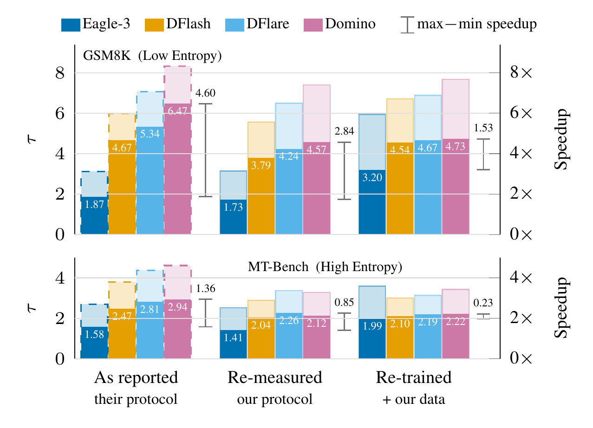
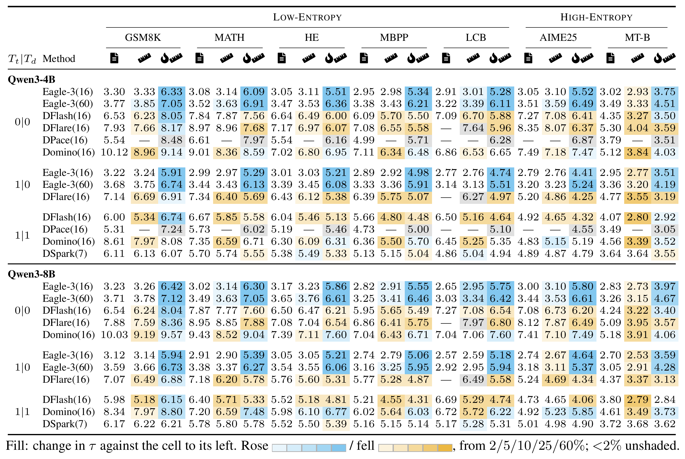
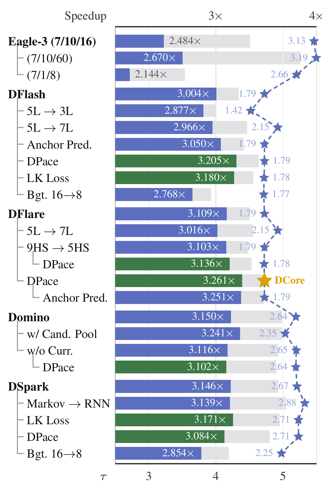
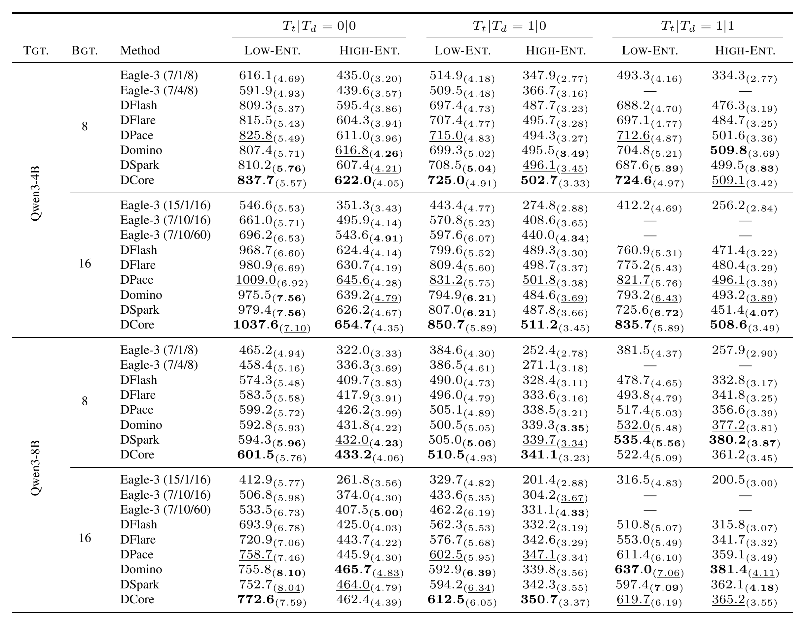
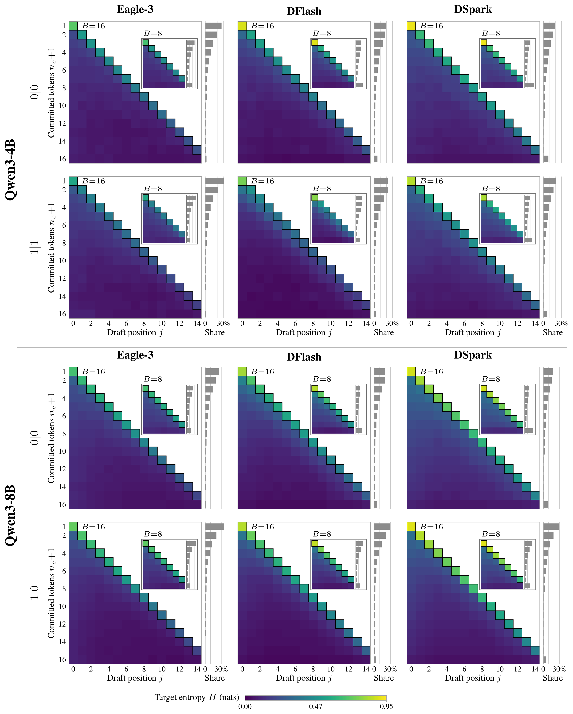
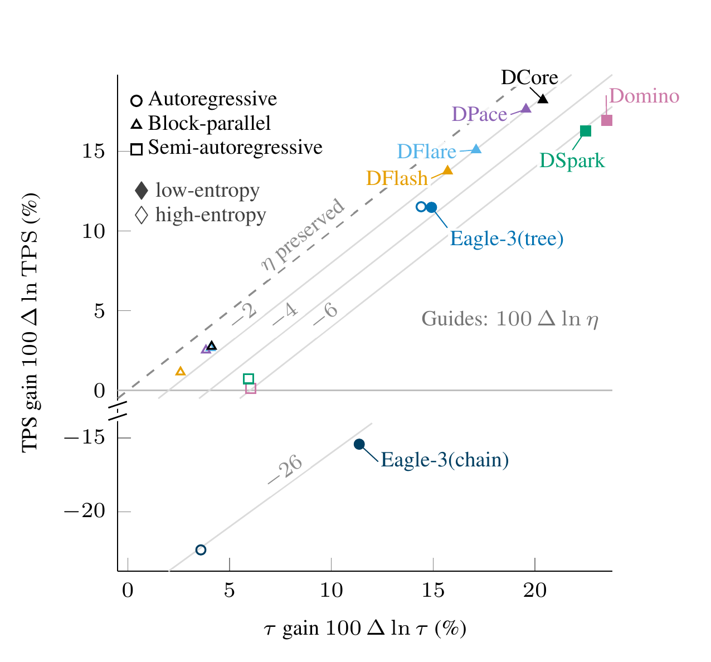
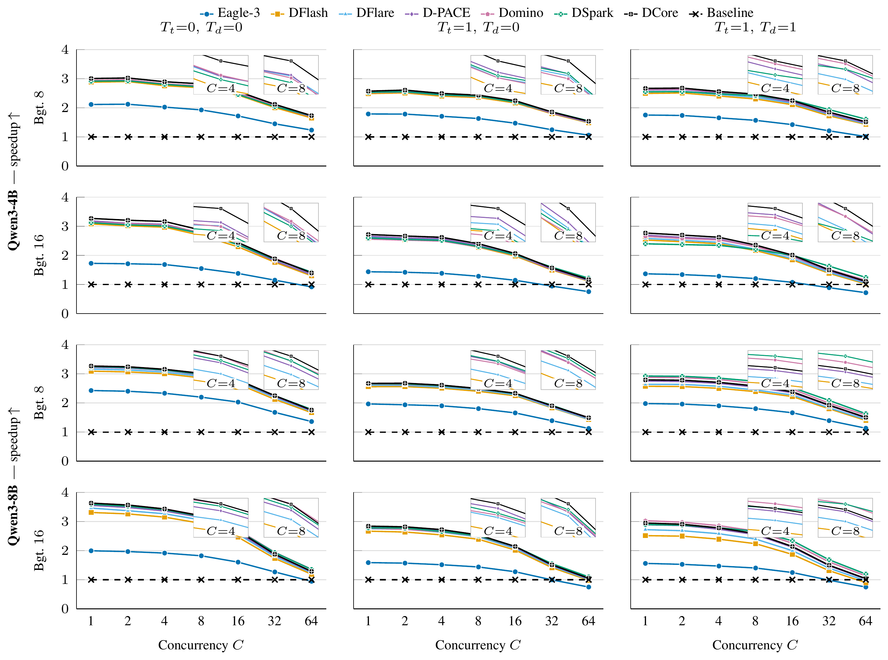

# When Does Better Acceptance Pay? A Controlled Study of Speculative Decoding

[English](README.md) | **中文介绍**

本仓库对应论文 **When Does Better Acceptance Pay? A Controlled Study of Speculative Decoding**（更高的接收长度，何时值得？一项投机解码的受控研究）。

代码和模型权重将在论文正式发表后公开。

## 接收更多 token，就一定生成得更快吗？

投机解码让轻量的**草稿模型（drafter）**提前提出若干 token，再由**目标模型（target）**并行验证。每一步接收更多 token，看起来当然是好事。但提出和验证这些 token 本身，也需要时间。

**最终目标是吞吐量，而不是接收长度。** 我们的问题是：*为了获得额外的接收长度，付出更多计算成本，什么时候才值得？*

我们在统一的训练、推理和评估协议下，比较自回归、块并行和半自回归三个家族的六种草稿方案，覆盖十个 benchmark 和两个目标模型。

**为什么选择这六种草稿方法？** EAGLE-3、DFlash、DFlare、D-PACE、Domino 和 DSpark 代表了当前主流 LLM 所关注的学习式草稿加速路线，使这项对比与实际模型的推理设计密切相关。故事围绕三个相连的决策展开：**如何比较方法、如何改进方法，以及改进何时能带来实际回报。**

## 1. 相信排名之前，先对齐比较条件

公开排名往往混合了不同训练数据和评估协议的影响。重新评估公开检查点，可以统一评估条件，却仍然保留了训练条件的差异。

**图 1** 区分三个层次：原论文**报告的结果**、在统一运行环境中**重新测量公开检查点**的结果，以及使用共享的目标模型生成数据**重新训练**、按统一协议评估的结果。

*浅色柱表示接收长度，实色柱表示加速比。从左向右，可以看到对齐条件后的变化。*

在 MT-Bench 上，最高与最低加速比之间的差距依次从 **1.36 缩小到 0.85，再到 0.23**。这些是加速倍数之差，并非百分比。原本显著的方法差距，变得小了许多。

**表 8** 将三阶段对比展开到七个 benchmark 和两个目标模型。不同方案的接收长度变化并不相同，重新训练也不是让所有方法一起上涨。

*每个 benchmark 下的三列依次是：原论文报告、重测、重训。蓝色／黄色表示相对前一阶段的接收长度上升／下降，不代表方法间的排名。比较方法时，应匹配预算和温度。点击图片可以放大。*

例如，在 Qwen3-8B、预算 16、目标模型｜草稿模型温度为 1｜0 的 MT-Bench 上，EAGLE-3 的接收长度依次为 **2.70 → 2.53 → 3.59**，DFlare 则为 **4.37 → 3.37 → 3.13**。共享数据重训之后，二者的接收长度排序发生了反转。

**仅比较公开检查点，不足以清楚地区分草稿方案本身的表现。** 对齐条件，才为我们深挖剩余差异提供了更可靠的起点。

## 2. 沿着成本分析，提炼出一个强基线

**图 2** 将组件和训练目标的变化，与执行成本放在一起观察。

*彩色柱表示加速比，浅色柱表示接收长度，星形标记表示草稿提出时延。金色星形标记对应 DCore。*

提高接收长度有两条路线：改进训练监督或目标上下文的利用，在已测配置中几乎不增加推理开销；或者通过更深的网络、更强的 token 条件依赖，增加计算。第二条路线是否值得，取决于接收长度收益能否覆盖新增成本。有效组件的组合，也需要实际检验。

这引出了 **DCore**：DFlash 的高效主干、DFlare 的目标层上下文混合，以及 D-PACE 的训练目标。在消融地图的配置中，加速比从 **3.004× 提升到 3.261×**，测得的草稿提出时延仍为 **1.79 ms**。

离开设计搜索，这个方案还有效吗？**表 1** 将 DCore 与全部六种重新训练的草稿方法进行比较。在由目标模型、预算、温度组合和任务熵分组构成的 **24 个单请求设定中，DCore 有 18 个取得最高平均吞吐量**。

*单元格表示每秒生成的 token 数，下标是接收长度；列标题给出目标模型｜草稿模型的温度。吞吐量和接收长度分别排名，粗体表示最佳结果。点击图片可以放大。*

DCore 是从分析中提炼出的强基线，而其他方法在部分设定下表现更好。这引出了下一层问题：**什么样的条件，会让某种方案更有优势？**

## 3. 观察任务的不确定性，而不只是领域标签

**熵**衡量对下一个 token 的不确定程度。即使两个任务都属于代码领域，它们的不确定程度也可能相差很大。因此，领域标签并不足以刻画草稿被接收的难度。

**完整熵热力图** 深入三个草稿家族的解码路径，覆盖两个目标模型、两种预算，以及图中标出的温度设定。被接收前缀的目标模型熵，往往低于终止这条路径的被拒绝位置。

*颜色越亮，目标模型的不确定程度越高；黑色边框标记被拒绝的位置。每个面板包含预算 16 的主图和预算 8 的小图。上两行是 Qwen3-4B 的 0｜0、1｜1，下两行是 Qwen3-8B 的 0｜0、1｜0。灰色柱表示各路径长度出现的频率。点击图片可以放大。*

这一反复出现的模式，让不确定性成为理解接收长度的一条线索。但接收长度，只是投入与回报的一侧。

## 4. 增加预算，可能更快，也可能更慢

**图 4** 比较 Qwen3-8B 在目标模型采样、草稿模型贪心解码时，将验证预算从 8 增加到 16 的变化。

*向右表示接收长度增加，向上表示吞吐量提高。实心／空心标记对应低熵／高熵任务。使用对数变化量，可以将吞吐量变化拆成接收长度变化与有效效率变化；斜向参考线表示后者。*

预算增加时，块并行方法最能保持有效效率。块并行和半自回归方法在低熵任务上获得最高约 **20%** 的吞吐量提升，但在高熵任务上最多只有 **2.8%**。EAGLE-3 扩宽候选树，在两组任务上都获得约 **12%** 的提升。相反，延长其逐 token 草稿链，在两组上都使吞吐量下降：额外接收长度不足以偿还增加的草稿时延。

块式方法比较的是对应预算的训练方案；EAGLE-3 的树与链比较则使用同一个检查点。这些单请求结果，引出了部署时的问题：**如果多个请求同时到来，结论还一样吗？**

## 5. 服务器负载，会再次改变答案

**图 9** 使用 **SpecMix**：将十个 benchmark 的请求混合并打乱，在逐步增加的并发量下评估。

*各行区分目标模型和预算，各列区分目标模型｜草稿模型温度。横轴是每个副本的并发请求数；加速比相对于相同负载下的目标模型单独解码，虚线是 1×。这里的 EAGLE-3 使用链式解码，小图帮助区分相近曲线。点击图片可以放大。*

较大预算在低负载时可能更快，但随着并发增加，可能被较小预算反超。DCore 在贪心草稿设定下保持竞争力，半自回归方法在采样草稿设定下更具竞争力。因此，选择草稿方法和预算时，既要看模型生成什么，也要看它如何被服务。

**实际启示是：** 先建立共同的比较基准，再寻找几乎不增加推理开销的接收长度改进，最后根据实际任务和服务条件下的端到端吞吐量，联合选择草稿方法与预算。

## 致谢

我们的实现基于 [SpecForge](https://github.com/sgl-project/SpecForge) 和 [SGLang](https://github.com/sgl-project/sglang)。感谢这两个项目的作者和维护者，为本工作提供训练与服务框架。

我们也感谢以下项目。其开源实现为我们的训练与评估代码提供了借鉴：

- [EAGLE](https://github.com/SafeAILab/EAGLE)：EAGLE-3。
- [DFlash](https://github.com/z-lab/dflash)。
- [D-PACE](https://github.com/Lucas-TY/D-PACE)。
- [AngelSlim](https://github.com/Tencent/AngelSlim)：DFlare。
- [Domino](https://github.com/jianuo-huang/Domino)。
- [DeepSpec](https://github.com/deepseek-ai/DeepSpec)：DSpark。
